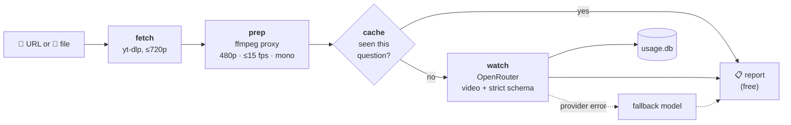

<div align="center">

# 🎞️ media-watch

**Let AI agents actually watch videos.**

Paste a reel, TikTok, YouTube Short, or local clip. Get back a structured, timestamped report of what's on screen,
what's said, and what it sounds like.

[](https://github.com/hunterbrewer04/media-watch/actions/workflows/ci.yml)
[](https://www.python.org)
[](LICENSE)
[](https://github.com/astral-sh/ruff)

[Quick start](#-quick-start) · [How it works](#-how-it-works) · [The report](#-the-report) · [Cost](#-models-and-cost) · [Configuration](#%EF%B8%8F-configuration)

</div>

---

<p align="center">
  
</p>
<p align="center"><sub>A real run on a <a href="https://www.youtube.com/shorts/qoQIoyTUKhQ">Blender Studio Short</a> about their open game DOGWALK. Recorded with <a href="https://github.com/charmbracelet/vhs">vhs</a> from <a href="docs/demo.tape"><code>docs/demo.tape</code></a>; the ~10s model wait is cut.</sub></p>

## Why

Send an agent a video link and it usually can't see the video at all. The usual workaround is to grab a few still
frames, which loses the speech, the music, the motion, and anything that happens between frames.

media-watch passes the whole clip, audio included, to a model that can take video as input
([Gemini](https://deepmind.google/technologies/gemini/) via [OpenRouter](https://openrouter.ai)). It forces the
answer into a strict JSON schema, so your agent gets data it can reason over instead of a paragraph of vibes. It
costs about a cent per short video, and every call is logged, so you always know what you've spent.

## ✨ Features

- **Works with links or files.** YouTube, TikTok, Instagram, Facebook, X and Reddit links, plus anything else
  [yt-dlp](https://github.com/yt-dlp/yt-dlp) supports, and local files.
- **Structured output.** Summary, a direct answer to your question, a timestamped timeline, verbatim on-screen
  text, a speech transcript, an audio description, notable moments, and an explicit list of what the model
  wasn't sure about.
- **Cheap by design.** Videos are shrunk to a small proxy before upload. Follow-up questions reuse the cached
  proxy, and repeating a question costs nothing.
- **Resilient.** Invalid JSON gets one retry. Provider errors get one try on a fallback model, but only when
  switching models could actually help.
- **Exact cost tracking.** Every call goes into a local SQLite log, including failures and cache hits, with the
  real cost reported by OpenRouter. `mw stats` summarizes it.
- **Safe to hand to an agent.** Results are labeled as untrusted content, so text or speech in a video can't
  hijack your agent through prompt injection.
- **Use it anywhere.** As a [Hermes Agent](https://github.com/NousResearch/hermes-agent) plugin, the `mw` CLI, or a
  plain Python library with no agent-framework dependency.

## 🔧 How it works



| Stage | What happens |
|---|---|
| **fetch** | yt-dlp downloads the video at 720p or lower. Tracking parameters (`igsh`, `si`, `utm_*`, …) are stripped first, so the same reel shared twice is only downloaded once. Local files are used in place and never copied. |
| **prep** | ffmpeg builds a proxy: 480p on the short side (scoreboards and captions stay readable), at most 15 fps, mono audio, and under ~14 MB so the base64-encoded request fits within Gemini's inline limit. |
| **watch** | One request with the video, your question, and a strict JSON schema. The response is checked with pydantic and retried once if it's malformed. |
| **fallback** | Outages, rate limits, and bad output get one attempt on a second model. A bad key, an empty balance, or an oversized file doesn't, because switching models won't fix those. |
| **log** | Tokens, exact cost, latency, and errors go to `usage.db` for every call, including calls that failed partway through. |

## 🚀 Quick start

**You'll need** Python 3.11+, [`ffmpeg`](https://ffmpeg.org) and [`yt-dlp`](https://github.com/yt-dlp/yt-dlp) on
your machine (plus `node` or `deno` if you want yt-dlp to handle YouTube's JS challenges), and an
[OpenRouter API key](https://openrouter.ai/keys).

### CLI

```bash
pip install "git+https://github.com/hunterbrewer04/media-watch"   # or: uv tool install git+https://…
export OPENROUTER_API_KEY=sk-or-...

mw watch "https://www.tiktok.com/@user/video/123"                  # general summary
mw watch "https://youtu.be/abc" -q "what song is playing?"         # ask a question
mw watch ~/clips/goal.mp4 --detail high --json                     # stronger model, raw JSON out
mw stats --days 30                                                 # what you've spent
```

`--detail` picks the model tier: `fast` (cheapest, can hallucinate), `normal` (default), or `high` (slower and
pricier, for when accuracy really matters). `--no-cache` forces a fresh model call.

### Python

The core library has no agent-framework dependency, so you can drop it into any agent:

```python
from mediawatch import watch

result = watch("https://youtu.be/abc", question="what song is playing?")
print(result.report.answer)
print(result.cost_usd, result.model)
```

If a download, encode, or model call fails, `watch()` raises `mediawatch.WatchError` with a readable message.

### Hermes Agent plugin

```bash
git clone https://github.com/hunterbrewer04/media-watch.git ~/Code/media-watch
ln -s ~/Code/media-watch/plugin ~/.hermes/plugins/media-watch
hermes plugins enable media-watch
```

Put `OPENROUTER_API_KEY` in `~/.hermes/.env` (the plugin uses Hermes' profile-aware secret lookup), then restart
the gateway or dashboard. The `media` toolset is on by default. Hermes' Python already ships `httpx` and `pydantic`,
so there's nothing else to install. Keep the clone where it is, because the plugin loads the library from the repo
next to it.

Then just talk to your agent:

> **You:** https://www.youtube.com/shorts/qoQIoyTUKhQ what's the joke?
>
> **Agent:** *(calls `watch_video`)* A developer demos a "karma" mechanic where dragging the kid through snow and
> bushes makes them cry, then deadpans: "So maybe don't do that."

## 📋 The report

Every watch returns the same shape, enforced by the JSON schema and validated before it reaches you:

| Field | What's in it |
|---|---|
| `summary` | 2–4 sentences: what the video is and what happens |
| `answer` | A direct answer to your question (empty if you didn't ask one) |
| `content_type` | reel, tutorial, gameplay clip, meme, news, vlog, ad, … |
| `timeline` | Timestamped beats: `{start_s, end_s, description}` |
| `on_screen_text` | Captions, scoreboards, handles and watermarks, verbatim |
| `speech` | A transcript of what's said or sung |
| `audio` | Music, sound effects, crowd noise, tone |
| `notable_moments` | Highlights worth clipping: `{t_s, label, why}` |
| `uncertain` | Anything the model couldn't see or hear clearly, or is guessing about |

<details>
<summary>Example JSON (the report from the demo above, <code>on_screen_text</code> trimmed)</summary>

```json
{
  "summary": "A game developer explains a new 'karma' or mood mechanic in their video game, where the player controls a dog walking a child on a leash. If the player drags the child face-first through snow, into trees, and across frozen lakes ('basically abusing the child'), the child starts crying, leading the developer to jokingly suggest not doing that.",
  "answer": "The joke is the developer describing gameplay where the player drags a kid face-first through snow, bushes, and ice as 'basically abusing the child,' pointing out that it makes the kid cry, and wryly advising 'so maybe don't do that.'",
  "content_type": "reel",
  "timeline": [
    { "start_s": 0.0, "end_s": 4.5, "description": "A developer discusses implementing a 'karma' mechanic tracking the child's mood in the game." },
    { "start_s": 4.5, "end_s": 9.2, "description": "A colleague plays the game on a handheld console (Steam Deck)." },
    { "start_s": 9.2, "end_s": 20.6, "description": "Gameplay shows a fluffy dog dragging a child along on a leash across snow and frozen water until the kid cries." },
    { "start_s": 20.6, "end_s": 26.0, "description": "The developer laughs and concludes with 'So maybe don't do that.'" }
  ],
  "on_screen_text": ["THE OTHER BIG", "MISSING IS", "BASICALLY WHAT WE", "CALL FOR A", "WHILE KARMA,", "SO", "MAYBE", "DON'T DO THAT."],
  "speech": "The other big thing that was missing is basically what we call, for a while, karma, which is like the kid's mood as you are doing certain actions. So if you keep pulling the kid to the ground, through the snow, smacks into bushes and trees, basically abusing the child, that is going to be followed up by a reaction of the kid starting to cry. So maybe don't do that.",
  "audio": "Developer talking in an office setting with slight ambient noise and in-game sound effects, followed by chuckling.",
  "notable_moments": [
    { "t_s": 14.5, "label": "Child dragged across ice", "why": "Humorous gameplay moment showing the fluffy dog dragging the kid face-down across the lake." },
    { "t_s": 22.5, "label": "Developer's punchline", "why": "Developer laughs and delivers the advice: 'So maybe don't do that.'" }
  ],
  "uncertain": []
}
```

</details>

## 🌐 Supported sources

Anything yt-dlp can download should work. These were verified without cookies in October 2026:

| Source | Status |
|---|---|
| YouTube / Shorts | ✅ |
| TikTok | ✅ |
| Instagram reels (public) | ✅ |
| Facebook videos (`/watch/?v=`) | ✅ |
| Facebook **Reels** | ❌ yt-dlp's parser is broken upstream. Send the file instead. |
| Private or login-walled posts | 🍪 Needs a `cookies.txt` (see [Configuration](#%EF%B8%8F-configuration)) |
| Local files (mp4, mov, webm, mkv, …) | ✅ |

Videos longer than 10 minutes are refused by default, as a guard against expensive random links. Raise the limit
with `MEDIA_WATCH_MAX_SECONDS`.

## 💸 Models and cost

From a bake-off on 2026-10-09 with a 5.6-second clip:

| Model | Latency | Cost | Verdict |
|---|---|---|---|
| `google/gemini-3.8-flash` | 5s | $0.0025 | Accurate, good timestamps, catches sound effects, lyrics and on-screen text. **Default.** |
| `qwen/qwen3.8-omni-flash` | 20s | $0.0007 | Most detailed, but slow. **Fallback.** |
| `google/gemini-3.1-flash-lite` | 3s | $0.0005 | Hallucinated an event in testing. `fast` tier only. |

In real use, a typical short video (under about 75 seconds) costs **$0.004–0.011**.

### Tracking spend

Every call, including failures and cache hits, is written to `usage.db`. Each row records the timestamp, caller
(the Hermes profile), source, site, video length, model, prompt version, question, tokens, **exact cost from
OpenRouter** (failed requests included), latency, and any error.

```text
$ mw stats
Last 7 days: 11 calls (6 ok, 1 cached, 0 fallback) · $0.0297 · 2.3 min of video · avg 9.1s
  google/gemini-3.8-flash                 6 calls  $0.0297  avg 9.1s
  sites: instagram 3/4, tiktok 2/2, youtube 1/3
```

Requests are tagged `X-Title: media-watch`, so they also show up as their own entry on your OpenRouter activity page.

### Caching

- **Downloads and proxies** are cached per video. Local files are keyed by path, size, modification time, and
  their first and last bytes.
- **Reports** are cached per video, model, question, and prompt version. Asking the same thing twice is free; a new
  question reuses the proxy and pays only for the model call.
- There's no automatic cleanup yet. Delete `MEDIA_WATCH_HOME/items/` whenever you like.

## ⚙️ Configuration

Everything comes from environment variables, and only the API key is required. See [`.env.example`](.env.example).
The CLI also falls back to the `OPENROUTER_API_KEY` line in `~/.hermes/.env` if the key isn't in your environment.

<details>
<summary>All settings</summary>

| Variable | Default | What it does |
|---|---|---|
| `OPENROUTER_API_KEY` | (required) | Your OpenRouter key |
| `MEDIA_WATCH_MODEL_NORMAL` | `google/gemini-3.8-flash` | Default model |
| `MEDIA_WATCH_MODEL_HIGH` | `google/gemini-3.1-pro-preview` | `--detail high` model |
| `MEDIA_WATCH_MODEL_FAST` | `google/gemini-3.1-flash-lite` | `--detail fast` model |
| `MEDIA_WATCH_FALLBACK_MODEL` | `qwen/qwen3.8-omni-flash` | Tried once if the main model errors. An empty string disables it. |
| `MEDIA_WATCH_MAX_SECONDS` | `600` | Longest video it will watch |
| `MEDIA_WATCH_PROXY_FPS` | `15` | Frame-rate cap for the proxy. Gemini samples about 1 fps, so lower values shrink uploads. |
| `MEDIA_WATCH_HOME` | `~/.hermes/cache/media-watch` | Where downloads, proxies, reports and `usage.db` live |
| `MEDIA_WATCH_COOKIES` | `~/.config/media-watch/cookies.txt`, if it exists | Netscape-format cookies for login-walled sites |
| `MEDIA_WATCH_FFMPEG`, `MEDIA_WATCH_FFPROBE`, `MEDIA_WATCH_YT_DLP` | auto-detected | Explicit binary paths (handy under systemd's minimal `PATH`) |

</details>

## 🔒 Security and privacy

- **Where your video goes.** The proxy is sent only to OpenRouter and the model provider it routes to. Nothing is
  uploaded anywhere else.
- **Untrusted content.** On-screen text and speech come from arbitrary videos and may contain prompt injection. The
  Hermes tool labels every report as untrusted, so the agent reports on it instead of following instructions found
  in it. If you wire the library into another agent, do the same.
- **Secrets.** No keys live in the repo. `.gitignore` blocks `.env*`, cookie files, databases and media, and CI runs
  [gitleaks](https://github.com/gitleaks/gitleaks) on every pull request and every push to `main`.
- **Cookies.** A `cookies.txt` is a logged-in session for that site. Keep it `chmod 600` and never commit it.
- Only download and analyze content you have the right to, and respect each site's terms of service.

## 🛠️ Development

```bash
git clone https://github.com/hunterbrewer04/media-watch.git && cd media-watch
uv run --with pytest --with-editable . pytest   # OpenRouter is mocked; the test clip is generated by ffmpeg
uvx ruff check .
```

<details>
<summary>Project layout</summary>

```text
mediawatch/        core library (no Hermes imports)
  config.py        settings from env
  binaries.py      finds ffmpeg / ffprobe / yt-dlp, even under a minimal PATH
  fetch.py         URL → yt-dlp → cache | local path → used in place
  prep.py          ffprobe + small proxy
  models.py        report model + strict JSON schema
  watch.py         OpenRouter call, validation, retry + fallback, caching
  usage.py         SQLite usage log + stats
  cli.py           `mw watch`, `mw stats`
plugin/            Hermes plugin: registers `watch_video` (toolset `media`)
tests/             pytest suite
```

</details>

Issues and pull requests are welcome.

## License

[MIT](LICENSE) © Hunter Brewer
